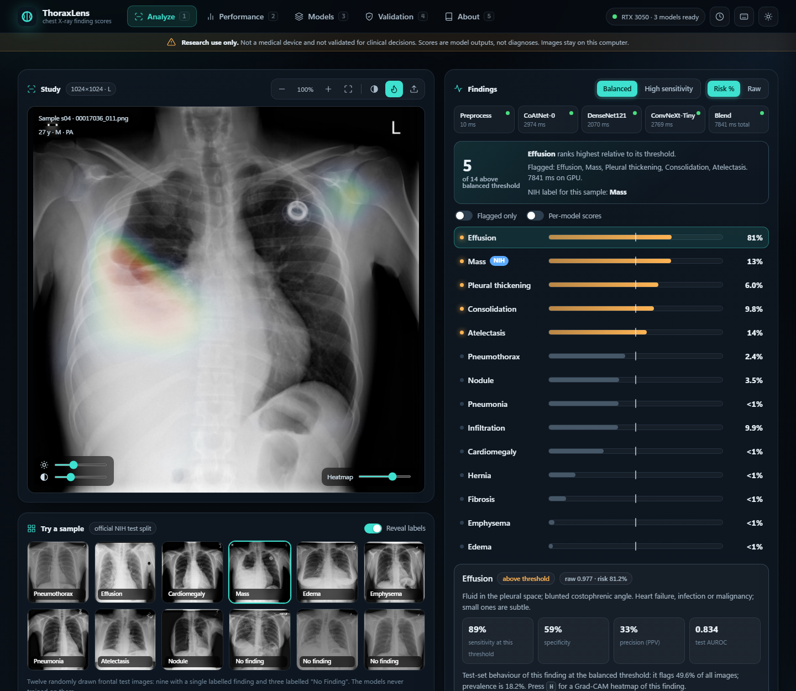

# ThoraxLens

Multi-label classifier for the 14 findings of NIH ChestX-ray14, with a local web app.
A three-model ensemble (CoAtNet-0 @224, DenseNet121 @320, ConvNeXt-Tiny @320; validation-chosen TTA and weights)
reaches **test mean AUROC 0.8289** (95% patient-level bootstrap CI 0.8231-0.8337) against 0.8201 for the single-model baseline.
Research use only; not a medical device.

- `REPRODUCE.md` - commands to rebuild caches, retrain, ensemble and validate
- `ui/README.md` - the web app (`python ui/server.py`, then http://127.0.0.1:8000)
- `outputs/validation/VALIDATION_REPORT.md` - full validation record
- `context.md` - project notes and history

Not included (too large, rebuildable): the NIH images, `outputs/images_*.npy` caches, and `last.pt` resume states.
Model checkpoints (`best.pt`) are stored with Git LFS.



## Setup

```
pip install -r requirements.txt
cp configs/local.example.yaml configs/local.yaml   # then edit it: where your NIH ChestX-ray14 files are
```

`configs/local.yaml` is git-ignored, so no machine-specific paths are committed. `outputs/splits.csv` stores image
file names only; full paths are built from `images_dir` at run time. Tests: `pip install pytest && pytest tests`.

## License

Code is released under the [MIT License](LICENSE). The NIH ChestX-ray14 dataset is distributed by the NIH Clinical
Center under its own terms and is not part of this license.
